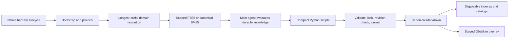

# Architecture

The local system follows a Bootstrap → Resolve → Read → Evaluate → Persist flow, with the adaptations and limits documented below.

| Component/flow | Implementation | Evidence and qualification |
| --- | --- | --- |
| Bootstrap and live hooks | install.py; integrations/setup.py; hooks/*_hooks.py; core/runtime.py | Native adapters for Codex, Claude, Factory, Copilot. Direct Codex install is exercised in temporary targets; other harnesses have payload contracts, not live sessions. |
| Domain resolution and scoped read | core/common.py; core/search.py; core/session_start.py | Longest-prefix binding; active/global scopes; foreign fallback only after zero scoped hits; explicit all scope. |
| Capture and controlled tagging | core/cli.py; core/notes.py; core/repository.py; core/tag_taxonomy.py | Script-only agent workflow, stable IDs, controlled four facets, subject+concern required for new capture, idempotency and duplicate checks. |
| Guard writes and review capture | core/runtime.py; core/capture.py; core/governance.py | Main agent makes the semantic decision. Stop requests at most one completion, and only after a real file change by the main agent (read-only shell commands, subagent calls and scratchpad writes do not count). Subagents are instructed/read-only in CLI. Cooperative governance, not an OS write barrier. |
| Validate, lock, write, derive | core/repository.py; core/governance.py; core/validate.py | Shared inventory that reports (never hides) unreadable, ID-less or duplicate files; BOM/CRLF-tolerant parsing; store lock; revision checks; durable journals that write new files before removing old ones and are rolled forward by the next transaction (`recover --abandon` for conflicts); retries through Windows sharing violations; rebuildable catalogs/indexes. |
| Markdown storage and lifecycle | core/notes.py; core/note_types.py; core/governance.py | JSON-compatible YAML frontmatter; schema-3 type-derived filename prefixes; active/resolved/archived/superseded states; bug type retains BUG prefix through resolve/reopen; stable IDs; direct journaled update/supersede; review dates by type; approved archive/merge/delete/remap; undo. |
| SQLite FTS5 | core/search.py | Sixteen note columns, composite domain/ID key, weighted FTS5, strict-to-broad query fallback, stemmed title/body coverage that ignores tags and very common words, newest-first status/plan topics, rank fusion with parent domains, canonical dirty fallback, word-bounded snippets and read-only SQL. |
| Obsidian sync | core/sync.py | Vault identity, copied/derived ownership, auto-applied edits, checkbox approvals, self-clearing conflicts with "keep my version", rename following, quiet period, vault-only properties, preserved user-edited views, managed `overlay-sync-all` at session end. Shared dashboards display the last built domain. |
| Tag vocabulary expansion | core/tag_taxonomy.py; core/governance.py | Exact-hash approved taxonomy and bulk-retag plans. Invalid overlay tags stay staged with a validation error until resolved. |

The regression suite in tests/ covers the reviewed failures and the principal local journeys. Tests include actual process termination/recovery, interrupted transactions, concurrent CLI writers, safe installation/uninstallation, vault editing and conflict scenarios, retrieval relevance, Stop-hook change detection, and non-destructive migration. See VALIDATION.md for limits.

## Deliberate adaptations and limits

- The ten note types and their use cases are defined in [NOTE_TYPES.md](NOTE_TYPES.md): knowledge, decision, preference, context, status, bug, plan, risk, research and policy. STATUS incorporates progress; corrections use KNOWLEDGE with the correction concern tag. Type is the source of truth: schema-3 canonical frontmatter has no independent prefix field; filenames and read/search metadata derive the uppercase prefix. Legacy notes, including progress/correction types, remain readable. `note-type-plan` converts existing notes only through a reviewed exact-digest plan, mapping progress to status, correction to knowledge and old BUG/RESOLVED prefixes to bug while preserving lifecycle status and stable identity.

- Storage is harness-independent: all adapters and scripts resolve one user-selected local data root from `~/.config/agentic-living-memory/config.json`. Setup suggests `~/LivingMemory`; the store contains canonical Markdown, bindings, taxonomy and durable history, while SQLite indexes and catalogs are derived. CLI/environment overrides remain explicit escape hatches and appear in diagnostics.
- The one-time CLI wizard initializes or connects a store. Exact-hash approved relocation copies and verifies existing data before publishing the new pointer, retains the original backup, and marks it retired for updated clients. A phase journal supports retry after interruption. Installed hooks use the chosen Python interpreter; Python 3.15 is supported. Harness installation and data ownership remain separate.
- This shared store serves one user on one computer. Adapters retain project-domain scoping and cooperative script governance; sharing a folder does not broaden retrieval scope or add a remote service.

- There are no background engines, daemons or extra model APIs; everything runs when a script or hook is called.
- The diagram's auto-memory bootstrap fallback is implemented as native managed instruction/protocol context rather than a skill. Native trust must still permit hook execution.
- Automatic capture means the main agent silently judges and invokes the capture script. It does not mean a deterministic hook can understand and save every useful fact independently.
- Canonical mutation is recoverable across files, not a filesystem-wide instantaneous transaction. Sync across two roots has separately recoverable phases. External tools can still edit files outside cooperative governance.
- Each hook is a Python process start (about 100-150 ms on this machine) plus retrieval (about 30-70 ms in-process for tens of notes). Retrieval reads every note in the domain, so it grows linearly; run scripts/benchmark.py for exact results (written to .cache/benchmark.json). There is no performance guarantee.
