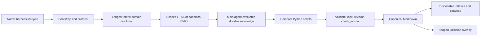

# Architecture

## Reviewed learning extension

`core/learning.py` adds explicit task evidence, isolated candidates, immutable procedure versions and actual-use feedback through the existing CLI/stdio bridge. Canonical Markdown remains authoritative for ordinary notes; journaled per-domain JSON sidecars govern learning state and evidence. Approved runbooks are projections of immutable versions. No model work runs in retrieval or hooks. See [learning contracts, operations and limits](LEARNING.md).

The local system follows a Bootstrap → Resolve → Read → Evaluate → Persist flow, with the adaptations and limits documented below.

| Component/flow | Implementation | Evidence and qualification |
| --- | --- | --- |
| Bootstrap and live hooks | install.py; integrations/setup.py; hooks/*_hooks.py; core/runtime.py | Native adapters for Codex, Claude, Factory, Copilot. Package install, adapter setup and the move from a CODEX_HOME install are exercised in temporary targets; other harnesses have payload contracts, not live sessions. |
| Domain resolution and scoped read | core/common.py; core/search.py; core/session_start.py | Longest-prefix binding; active/global scopes (`_global` is unbound and searched by every project; `capture --global` writes there, cross-domain duplicates are returned, refused or promoted, and `promote-plan` moves notes there by reviewed plan); foreign fallback only after zero scoped hits; explicit all scope. SessionStart: guidance notes in full plus a budgeted title index (progressive disclosure), 3,500-character cap with cheapest-first degradation. Notes it shows only as a snippet are `shown_snippet` in the session state (a prompt may still inject them in full; only full injections are deduplicated), and interim notes (core/notes.py `is_interim`: unconfirmed wording or a `**Hypothesis` label, no labelled resolution) are never gotchas and carry `UNCONFIRMED (as of date):` wherever a line shows them (strong phrases such as `unconfirmed`, `not yet verified` or `pending approval` count anywhere in the note; weak words such as `probably` or `suspect` only in the title or summary). Prompt retrieval (core/runtime.py `context`) searches a list prompt (three or more numbered, bulleted or question lines) item by item, up to eight queries and six injected notes in 2,400 characters; core/cli.py `ask` and `search` answer several questions one by one under `questions`. |
| Compaction handoff and recall | core/runtime.py; core/recall.py | The harness's summary carries the conversation. PreCompact (Claude) adds summarizer instructions: keep reasons and rejected alternatives, keep exact identifiers, and list unsaved durable statements. SessionStart(compact) injects the notes saved and surfaced this session plus the recall command. For five prompts afterwards, the prompt hook injects up to two strictly gated excerpts from before the compaction. Recall reads the harness's transcript (Claude JSONL or Codex rollout) on demand with BM25. Only its path is kept in the session state; excerpts mask `<private>` spans and redact credentials. |
| Codebase maps | core/maps.py; core/runtime.py; core/hookfast.py | One `map` note per repo, keyed by its folder in `files` and by repo identity (the normalized `origin` url, stored as the system-managed `repo` property and the index's `repo` column, so every clone and worktree of one origin shares the map), and found by repo rather than search scope (a child domain's map is visible from the parent). Prompts that name a repo get its map body once per revision, outside the hit cap, with its update date and, when a file it cites (its `files`, paths its body names, build files, decision documents) changed since, a `STALE:` line naming them (read from `git diff` between the last commit before the update and HEAD, cached per session by HEAD and in the store's derived `.cache/currency.json` (200 entries keyed by repo identity or path, note and update date, valid for the HEAD and note revision, so a new session at an unchanged HEAD runs no git; safe to delete)); the update date is the later of `updated` and `checked`, the timestamp `confirm` writes, so a confirmation clears the line until a later commit; Stop asks once per session to update a stale map the turn worked in; Read/Glob/Grep get a one-time pointer or count toward an exploration reminder, and an Agent spawn records the repo so SubagentStart can hand over its map; repeat reads are answered from session state by the standard-library fast path. |
| Project knowledge base | core/sources.py; core/digests.py; core/runtime.py; core/cli.py; scripts/ingest_run.py | Layer 1 of project-wide recall: a deterministic, rebuildable library of source excerpts. Registry `sources.json` (governed by `source-plan`, protected, backed up, shown by doctor) plus an implicit source per git repo under a bound folder; indexer in `domains/D/sources.sqlite3` (derived FTS5 and optional vectors; incremental by mtime, size and sha256; credentials redacted; chunks cite path and lines); `ask`, `search --sources`, `sources`, `source-sync`; SessionStart line plus detached background sync, UserPromptSubmit excerpts for prompts the notes cannot answer. Layer 2 (agent-written digests) is `core/digests.py`: a note's `sources: [{path, sha256}]` makes it a digest that reads STALE where it is injected once a file changes (a knowledge, runbook, policy, bug, risk or research note that lists files carries `file_hashes` of up to five of them and reads STALE the same way; hashes are compared through the derived, stat-keyed `.cache/file-hashes.json`; decisions, plans and statuses carry none), `ingest-scan` ranks the files still to digest, and `scripts/ingest_run.py` drives headless agents over that list. Layer 3 is `core/connectors.py`: `confluence` and `notion` source kinds that pull a live wiki into the derived cache `sources-cache/NAME/` (one HTML or Markdown file per page plus `manifest.json` with title, version, URL; incremental, removals followed) and are then indexed like an HTML export or Markdown folder, cited by page title and URL. Network stance: the store is local and stdlib-only, and this is its only network code besides the hash-pinned `semantic install` download; it is opt-in (a source must be registered through an approved `source-plan`), explicit (only `source-sync NAME` or `source-sync --all-remote` reach the network; hooks, the SessionStart background sync, `ask` and plain `source-sync` never do, and the permission layer never auto-allows a remote sync) and credentialed by environment variable (`token_env` names it; the token is never stored, logged or echoed in an error). Connections use https (http only for 127.0.0.1/localhost), refuse redirects to another host, time out after 20 s, retry 429/5xx at most three times, and are capped in pages, page size and total time. The cache is derived like `sources.sqlite3`: not canonical, not backed up, not relocated. SharePoint and Google Docs connectors are deferred. |
| Operational log | core/logs.py | Daily JSONL in STORE/logs: one line per hook run (event, domain, duration, outcome) and per command (exit code, duration), plus exceptions that fail-open housekeeping absorbs. Metadata only; messages redacted and capped, tracebacks as frames. At debug, each hook line explains its decision (gate verdicts per candidate, the path taken, the deny rule, the Stop reason, degradation) in refs, numbers and codes. Text (`LIVING_MEMORY_LOG_CONTENT`) only for a store marked `sandbox.json` that is not the configured root. `LIVING_MEMORY_LOG_LEVEL`, 30-day prune, `logs` command, `doctor` summary. Writes never raise; about 0.7 ms per hook. |
| Activity log and session ledger | core/activity.py; core/cli.py; core/runtime.py; core/backup.py | `log` is derived from records the store already keeps. Note edits come from the operation journals (each holds the note's text before and after, so the event is read from the change: created, updated, confirmed, superseded, resolved, archived, deleted, promoted, undone), change events from the `changes.json` effects, and neither is stored a second time: rows are cached per operation in `.cache/activity.json`, so only journals added since the last run are opened. Unfinished journals and the overlay bookkeeping kinds are skipped, and a deleted cache rebuilds. The one canonical part is the session ledger: at each Stop `record_session` appends `{t, s, h, d, p, n, f}` (time, session hash, harness, domain, project slugs, refs saved, files changed; no text) to `ledger/sessions-YYYY.jsonl`, only when the session's row changed since its last one (`ledger_sig` in session state). The file is append-only and never pruned; `log` keeps the last row of each session. Backups include it, a restore only adds to it, and PreToolUse denies direct edits like those of the other canonical files. |
| Note views | core/views.py; core/repository.py; core/cli.py; core/runtime.py; core/session_start.py; core/storage.py; core/backup.py; assets/ | A view is an entry in `views.json` (note ID, domain, short title, artifact URL and published revision) that shows one note as a self-contained HTML page. The page is derived and never read back: `view_model(note)` splits the note into items (Action items, numbered as `check --index` numbers them, with bracket tags, an ID and the matching `**ID:**` Details bullet as detail) and sections, and `render_html` writes one file with inline CSS, script, font and logo and the model as a JSON block that the script renders with text nodes only (no network, nothing from the note is markup). The single hook point is the end of `repository.reconcile()`, after the overlay block and whether or not `sync_overlay` is set, so agent writes, applied plans, `serve --stdio` and Obsidian sync all reach `views.refresh(domain, root)`. With no `views.json` it costs one stat; otherwise it re-renders the local page of each view in that domain whose note revision differs from the one cached in `.cache/views.json`, and it catches and logs its own errors (`logs.swallowed`) so a rendering failure never changes the write's receipt. Pages live under `.views/<domain>/`, which with `.cache/views.json` is excluded from snapshots and relocation (`views render --all` rebuilds it) and denied to agent writes; `views.json` itself is protected config, backed up, journaled through `repository.transaction` (kinds `views_add`, `views_remove`, `views_published`) and reverted by `undo`. The `artifact` target is a copy that someone else hosts: a local hook cannot push to claude.ai, so an artifact is refreshed only when a Claude session sees the hint in its session-start or prompt context (decided from `views.json` and the cache alone, with no note parsed) and republishes it with the Artifact tool, then records it with `views published`. Fonts and the logo are vendored as base64 text in `assets/` because the installer copies text files only. |
| Snapshots | core/backup.py | Verified zip of the canonical set (notes, registries and the session ledger) in STORE/backups, at most daily from session housekeeping, newest 7 kept; restore is an exact-hash plan. |
| Capture and controlled tagging | core/cli.py; core/notes.py; core/repository.py; core/tag_taxonomy.py | Script-only agent workflow, stable IDs, controlled four facets, subject+concern required for new capture, idempotency and duplicate checks. |
| Guard writes and review capture | core/runtime.py; core/capture.py; core/governance.py | Main agent makes the semantic decision. Stop requests at most one completion per reply. A receipt settles map/brief housekeeping, but a blocking statement stays pending unless a note captured, updated or confirmed in the turn shares content words with it (salted hashes stored at prompt time) or the turn was finalized as nothing durable, and a decision document or an edited file a note covers stays pending unless such a note covers it (`links`, `files`, `sources`) or the turn was finalized as nothing durable; map and brief housekeeping is asked only in sessions that changed something; a non-interactive run (`claude -p`) is told to end with its answer repeated in full. It asks for one when the turn holds knowledge that is easily lost: a deterministic durable-statement signal in the user's prompt that is blocking (remember, decision, directive memo; preferences and corrections are only nudged in the prompt's own context, and a repeated statement signals once, `.signals-seen.json`), a decision document changed by a main-agent write or shell edit (`core/triggers.py`; read-only shell commands, subagent calls and scratchpad writes do not count), a file edit after a note about that file was surfaced (`follow`; the notes about the files edited in a turn, up to five, share one sentence; Stop also looks up files past the hint cap and files a shell command or git changed in one batch, `search.files_notes`, unless HEAD moved by more than 3 commits or more than 30 files changed, which is a pull; after a pull the decision-document reminder leaves out the existing documents the pulled commits edited), or exploration of a repo that has no codebase map (three reads or a subagent spawn; once per repo per session). `stop_pending` collects what is owed and `stop_text` writes the reminder, capped near 700 characters. Claude receives it as Stop `additionalContext` (hook feedback, not a hook error). Subagents are instructed/read-only in CLI. Cooperative governance, not an OS write barrier. |
| Validate, lock, write, derive | core/repository.py; core/governance.py; core/validate.py | Shared inventory that reports (never hides) unreadable, ID-less or duplicate files, and that parses each note file once per process while its size and modification time are unchanged (a file changed in the last two seconds is always re-read; directories are checked for links once each, and every listed entry is refused if it is one); BOM/CRLF-tolerant parsing; store lock; revision checks; durable journals that write new files before removing old ones and are rolled forward by the next transaction, which reports them as `recovered` or as `warnings` (`recover --abandon` for conflicts; `--direction backward` only for unfinished operations); retries through Windows sharing violations; rebuildable catalogs/indexes. |
| Review worklist | core/worklist.py; core/usage.py; core/cli.py `review` | One read-only pass over a domain's active notes gives rows by kind (stale, due, interim, duplicate, warned, noisy), each note once with a reason and an action. Stale reads the digest and file hashes through core/digests.py and the maps' `.cache/currency.json` (no git); duplicates come from same-type pairs found through an inverted index of title stems and a sketch of each body's shingles, scored with `notes.TitleScorer` (numbered status titles leniently, capped below the capture-time refusal), so 1,500 notes scan in well under a second; noisy reuses `usage.noisy`. SessionStart (`core/session_start.py`, without duplicates) and the Obsidian Stale Notes page (`core/sync.py`) show the same rows. It proposes only; archive and merge are plans the user applies. |
| User brief | core/briefs.py; core/maps.py; core/session_start.py; core/notes.py | The one personal-memory note: a `brief` in a global domain with no `files`, no new note type. `maps.capture_conflict` keys it as the user brief (a second active one is refused; elsewhere a brief with no `files` is still an error). `briefs.find_user_brief` reads it from the global domains' indexes. SessionStart (`build_context`) renders it after the project line under `USER_BRIEF_BUDGET` (600 characters) and degrades it in the same loop as the other lines (whole block, summary, one-line pointer) before guidance snippets are shortened or dropped; it is left out of the title index and counts as shown only when the whole block is shown. `notes._user_brief_hint` adds the `user_brief` hint to `capture` and `update` results (advisory, fails open). |
| Markdown storage and lifecycle | core/notes.py; core/note_types.py; core/governance.py | JSON-compatible YAML frontmatter; schema-3 type-derived filename prefixes; active/resolved/archived/superseded states; plan, bug and risk notes keep their prefix through the direct, journaled resolve/reopen; stable IDs; direct journaled update/supersede; review dates by type; approved archive/merge/delete/remap; undo. |
| SQLite FTS5 | core/search.py | Nineteen note columns (including `commands` and `repo`, the identity of a map's or brief's repo) and a `vocab` table (stem to document frequency, built from active notes; schema version 3), composite domain/ID key, weighted FTS5, strict-to-broad query fallback, stemmed title/body coverage that ignores tags and very common words, rank fusion with parent and global domains after a per-domain relevance gate, optional semantic vectors fused by reciprocal rank (see below), canonical dirty fallback, word-bounded snippets and read-only SQL. |
| Obsidian sync | core/sync.py | Vault identity, copied/derived ownership, auto-applied edits, checkbox approvals, self-clearing conflicts with "keep my version", rename following, quiet period, vault-only properties, preserved user-edited views, managed `overlay-sync-all` at session end. Shared dashboards display the last built domain. |
| Tag vocabulary expansion | core/tag_taxonomy.py; core/governance.py | Exact-hash approved taxonomy and bulk-retag plans. Invalid overlay tags stay staged with a validation error until resolved. |

The regression suite in tests/ covers the reviewed failures and the principal local journeys. Tests include actual process termination/recovery, interrupted transactions, concurrent CLI writers, safe installation/uninstallation, vault editing and conflict scenarios, retrieval relevance, Stop-hook change detection, and non-destructive migration. See VALIDATION.md for limits.

## Deliberate adaptations and limits

- The thirteen note types and their use cases are defined in [NOTE_TYPES.md](NOTE_TYPES.md): knowledge, decision, preference, context, status, bug, plan, risk, research, policy, map, runbook and brief. STATUS incorporates progress; corrections use KNOWLEDGE with the correction concern tag. Type is the source of truth: schema-3 canonical frontmatter has no independent prefix field; filenames and read/search metadata derive the uppercase prefix. Legacy notes, including progress/correction types, remain readable. `note-type-plan` converts existing notes only through a reviewed exact-digest plan, mapping progress to status, correction to knowledge and old BUG/RESOLVED prefixes to bug while preserving lifecycle status and stable identity.

- Storage is harness-independent: all adapters and scripts resolve one user-selected local data root from `~/.config/agentic-living-memory/config.json`. Setup suggests `~/LivingMemory`; the store contains canonical Markdown, bindings, taxonomy and durable history, while SQLite indexes and catalogs are derived. CLI/environment overrides remain explicit escape hatches and appear in diagnostics.
- The one-time CLI wizard initializes or connects a store. Exact-hash approved relocation copies and verifies existing data before publishing the new pointer, retains the original backup, and marks it retired for updated clients. A phase journal supports retry after interruption. Installed hooks use the chosen Python interpreter; Python 3.15 is supported. Harness installation and data ownership remain separate.
- This shared store serves one user on one computer. Adapters retain project-domain scoping and cooperative script governance; sharing a folder does not broaden retrieval scope or add a remote service.

- There are no background engines, daemons or extra model APIs; everything runs when a script or hook is called.
- Semantic search is optional and off until `semantic install`. A model2vec static model (potion-retrieval-32M) is a WordPiece vocabulary plus one embedding row per word piece. core/semantic.py reads it with the standard library: BERT normalization, greedy WordPiece, rows read from a memory-mapped safetensors file, mean then unit length. An index rebuild embeds only notes whose file changed and carries the other vectors over from the index it replaces, when the same model revision made them. The parsed tokenizer is kept beside tokenizer.json as `tokenizer.marshal` (stdlib `marshal`, keyed by the source's size and mtime inside the file, rebuilt when missing or stale, skipped when the folder is read-only; derived, safe to delete), so a hook process does not parse the 1.5 MB JSON each time. It matches model2vec's own vectors (cosine 1.0 on note texts). Each index gains a `vectors` table (title plus summary). The installed model is part of the index fingerprint, and the lexical and semantic rankings are fused by reciprocal rank (k = 60), so a note matching both wins. A static model averages word meanings and does not read word order. The relevance gate keeps every lexical rule and admits a meaning-only match at cosine 0.45 or more, tuned on the eval so that unrelated prompts inject nothing. An unreadable model leaves search lexical. Loading the model adds about 30 ms to a hook's process start, and retrieval about 7 ms.
- Memory units and the unit index (core/units.py, core/vectors.py). Each note is also cut into units: an overview (title plus summary, the same text as the note-level vector), the `> **Important:**` caveat, and one unit per `##` to `####` section, found fence-aware, with its heading path, a role read from the heading (Why is rationale, Alternatives considered is alternative, Steps and Roll back are procedure, and so on; Links and Action items are skipped) and its line span in the note file. A section longer than 360 words is split between paragraphs, never inside a fenced block. Unit ids come from the note id, the normalized heading path and an occurrence count, so a moved section keeps its id; the text's SHA-256 decides re-embedding, so a moved section costs nothing and an edited one re-embeds alone. The units live in a derived sidecar per domain, `domains/D/vectors.sqlite3` (unit metadata and excerpts, one embedding per distinct text, and a `meta` table with the schema version, model identity, dimension, generation and the note index's fingerprint). It is written by `rebuild_index` under the store lock, in one transaction per write that bumps `generation`; a schema, model or mode change, or a file that does not open, rebuilds it into a temporary file that replaces it. Hooks only read it. `search.sqlite3` is unchanged, so code without the extension still opens and rebuilds it. The semantic channel finds notes on its own (a note with no query word can rank), scores each note by its best unit (never a sum, so length earns nothing) and fuses with FTS5 by the same RRF; lexical score, similarity, fused rank and gate verdict stay separate fields. A unit index that does not match the note index's fingerprint or the model is never read: search falls back to the note-level vectors and says why (`backend`, `backendReason` on each hit).
- Optional native vector search (core/vectors.py). When the `sqlite-vec` package is installed (`pip install sqlite-vec==0.1.9`; versions 0.1.6 to below 0.2 are accepted), the unit index also holds a `vec0` table (`float[DIM]`, cosine) written in the same transaction as the units, and queries use its exact KNN, widening k (from 200, at most 4096, vec0's ceiling) until enough eligible notes are found, so retired or filtered notes cannot crowd out active ones. The library is located with `importlib.util.find_spec` (importing the package would load numpy when present) and loaded only from that fixed path, with extension loading switched on for that one call and off again. Backends, chosen per query: `native` (extension loaded, `vec0` written in the current generation), else `python` (the same embeddings, Python dot product; reasons `not_installed`, `load_unsupported`, `load_blocked`, `unsupported_version:V`, `disabled`, `native_stale`, `native_absent`, `knn_error`, `knn_k_cap`), else note-level vectors (`notes`), else FTS5 alone (`lexical`). Native and Python rank identically on the same embeddings (top 20 agree, scores within 1e-6); the native table changes speed, not results. A write made without the extension leaves the native table stale until a write with it resyncs the table in full. `semantic native off` (or `LIVING_MEMORY_NATIVE=0`) switches it off. Sources use sqlite-vec's `vec_distance_cosine` over their existing `vec` table, with no second table; without the extension they are scanned in Python.
- The injection controller (core/injection.py) decides, per relevant note, how much to deliver: a pointer (the line format before units), evidence (the summary's opening, then one section's heading, file lines and up to 300 characters, cut at a sentence end), or expanded (the section up to 1,200 characters, when the prompt asks for the steps, all alternatives or the details). A section is chosen by a role cue in the prompt ("why", "turned down", "fixed", "how do I"), else by meaning (similarity at or above the model threshold, plus 0.05 per shared prompt word, beating the overview), else by at least two shared words. A rejected-options section is always labelled as such. Whole-prompt acknowledgments ("thanks", "go ahead") retrieve nothing. A short follow-up with a cue and no topic of its own ("why?", "what were the alternatives?") answers from the notes the previous prompt found; the session keeps those refs, never prompt text. Dedupe is per unit and level: a session that has a note's Why at evidence level still gets its Alternatives, a new revision, a deeper level, or an explicit "remind me"; a new session or a compaction starts clean. The prompt hook has one budget of 4,000 characters (Codex's limit for this hook): the header, maps and brief and governance lines always go out, note lines get what they leave (the first always), and source excerpts and post-compaction recall join only when they fit. `read REF --section HEADING` reads one section; `search --explain` shows the backend, scores, gate and the level the hook would choose.
- The diagram's auto-memory bootstrap fallback is implemented as native managed instruction/protocol context rather than a skill. Native trust must still permit hook execution.
- Automatic capture means the main agent silently judges and invokes the capture script. It does not mean a deterministic hook can understand and save every useful fact independently.
- Canonical mutation is recoverable across files, not a filesystem-wide instantaneous transaction. Sync across two roots has separately recoverable phases. External tools can still edit files outside cooperative governance.
- Each hook is a Python process start (about 100-150 ms on this machine) plus retrieval (about 30-70 ms in-process for tens of notes). Retrieval reads every note in the domain, so it grows linearly; run scripts/benchmark.py for exact results (written to .cache/benchmark.json). There is no performance guarantee.
