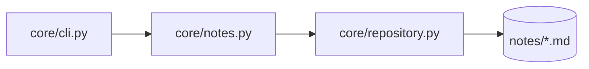

# Writing notes

A note is read cold, often months later, by an agent or a person who was not there when it was written. Often they see only the first sentence, in a session-start line or a search snippet. Write for that reader: say the thing plainly, in the words you would use to tell a colleague, and stop.

The rules below adapt two sources to memory notes: [humanizer](https://github.com/blader/humanizer) v4.0.0 (MIT) and Wikipedia's [Signs of AI writing](https://en.wikipedia.org/wiki/Wikipedia:Signs_of_AI_writing). Both describe how model text drifts toward the most likely phrasing for the widest audience, so it comes out generic and inflated. Notes are reference text, so they stay neutral and plain: no humor, no opinions, no asides.

Notes also follow any writing rules in the user's instruction files (`CLAUDE.md`, `AGENTS.md`, `copilot-instructions.md`). Where those rules differ from this page, the user's rules win, the way humanizer lets a writing sample override its patterns. [templates/](templates/) has a starter instruction file whose Writing style section matches this page.

`capture` and `update` check for most of these habits and return `style:` and `shape:` lines in `quality_warnings`. The warnings are advisory: the note is saved either way. A runbook without a "When not to use" section gets a `shape:` warning, because a runbook without one gets applied where it does not fit; say there what to do instead.

## The summary

The summary is the opening paragraph, before any heading. It carries the note on its own.

- Open with the fact, the decision or the problem. The first sentence must make sense with nothing around it.
- Say who decided and when, with an absolute date: "On 2026-11-12 the user chose ...". Never "yesterday" or "recently".
- One or two sentences, about 60 words at most. Put the rest in sections.
- Don't restate the title, and don't announce the note ("This note records ...").

Before:

> On 2026-11-11 the user approved a 7-phase remediation of Living Memory driven by the alm-simulation-benchmark findings: capture load-bearing knowledge from docs and code as concise pointer notes, block Stop once per reply everywhere when docs, decisions or described files change, a living project brief per project, command hints and better long-prompt retrieval, ...

After:

> On 2026-11-11 the user approved a seven-phase fix of Living Memory, based on what the alm-simulation-benchmark runs found. The phases are listed under Why; the deferred work is under Alternatives considered.

## Sections by type

Every note starts with the summary and an optional caveat (`--important`, shown as `> **Important:** ...` right after the summary). After that, the type decides the shape.

| Type | The summary says | Sections, in this order |
|---|---|---|
| knowledge | the fact | short sections named after what they explain, written as paragraphs |
| decision | the choice, who made it, when | Why; Alternatives considered |
| bug | the symptom | Cause (or a sentence starting "Hypothesis:"); Fix; How to check |
| runbook | what the procedure does | When to use; When not to use; Steps (numbered); Check; Roll back |
| research | the question and the answer so far | Findings; Sources; Open questions |
| map, brief | what the repo or project is | Details, with the fixed bold labels (see [NOTE_TYPES.md](NOTE_TYPES.md)) |
| preference, context, status, plan, risk, policy | the point | Details |

Write a section with `--section 'Heading' 'Text'` on `capture` or `update`. On `update` it replaces only that section. `--drop-section 'Heading'` removes one. Links go under Links (`--link`), and open steps of a plan, bug or risk go under Action items (`--action`).

## Diagrams

Draw a Mermaid diagram when a flow, sequence, state change or module layout is easier to see than to read. Obsidian draws them, and so does the Hivemind note view; the terminal and the dashboard show the source.

| Type | A diagram that usually helps |
|---|---|
| map | a `Data flow` section with a flowchart of how a request or a write moves between modules |
| runbook | the steps when they branch, or the roll-back path |
| knowledge | a request flow (`sequenceDiagram`), a lifecycle or a state machine (`stateDiagram-v2`) |
| decision | the shape before and after the change, in Why or its own section |
| bug | the failing call path, in Cause |

Leave diagrams out of preferences, policies, briefs, one-line facts and anything a short list says as well.

- Put the diagram in a section, after a sentence that says what it shows. Search and the prompt hook read that sentence; they do not read the diagram well.
- Use `flowchart`, `sequenceDiagram` or `stateDiagram-v2`, with about 12 nodes at most and one diagram per section.
- Label nodes with the real module, command or state names, and quote a label that holds punctuation: `A["alm read"]`.
- Update the diagram with the note. A diagram that disagrees with the text is worse than none.
- Pass it with `--section 'Data flow' '...'` (real newlines inside the quotes) on `capture` or `update`, or write the whole body to a file for `capture --content-file FILE`. Not with `--detail`, which makes a bullet of the first line.
- PowerShell 5.1 mangles double quotes inside arguments to native commands, so a label such as `A["alm read"]` breaks. From PowerShell, capture with `--content-file`, and run `update --section` from Bash. `update --body-file FILE` also works, but it replaces the whole body.

````markdown
## Data flow

A write goes from the CLI through governed notes to the journaled repository, which writes the Markdown.


````

The content checks skip Mermaid fences, so state names such as `Pending` or `todo` in a diagram do not raise the unfinished-state warning, and the style checks skip all fenced code.

## Action items for a dashboard

Any plan, bug or risk note can be shown as a dashboard (`views add REF`, see [SCRIPT_REFERENCE.md](SCRIPT_REFERENCE.md)). The dashboard reads an Action item's text by one convention, and a note that does not follow it still shows, only without tags and IDs.

- Start the text with one or more bracket groups, each a comma-separated list of tags: `[P2] [ALM] ...` or `[ALM, HM] [approved] ...`. The dashboard turns each tag into a badge and a filter chip. `P1`, `P2` and `P3` set the priority order.
- Next comes an ID if the item has one: capitals, digits and hyphens, with at least one hyphen or digit (`CUR-1`, `HM-P4`, `MAP-REKEY`, `UX-Q2`). A plain capitalized word such as `API` is not an ID.
- The rest is the item's title: `- [ ] [P2] [ALM] HOOK-4 Cap the total UserPromptSubmit context below the hook-context limit`.
- Put the longer explanation in a Details bullet whose bold label is the ID: `- **HOOK-4:** the UserPromptSubmit path in core/runtime.py ...`. Indented lines under the bullet belong to it. The dashboard shows that text when the item's card is opened, and leaves the bullet out of the Details list. Write one such bullet per ID; an item with no ID or no bullet simply has no detail.
- To date an item or give it an owner, end the text with a tail of `due`, `owner` and `priority` in any order: `- [ ] [P2] [ALM] CUR-1 Ship the release (due: 2026-12-01, owner: me, priority: high)`. `due` is a real `YYYY-MM-DD` date and `priority` is `highest`, `high`, `medium`, `low` or `lowest`. A parenthesis group that holds any other key, or is not at the very end, is plain text. A bad value is ignored and `capture` and `update` warn about it; the text is never rejected.
- Change the fields of one item with `update REF --item TEXT --due D`, with `--owner NAME` and `--priority P` as well (`none` clears a field), or `--item-index N` to name the item by its position. `open` shows `due`, `owner`, `priority` and `overdue` for each item and takes `--due-by DATE`, `--owner NAME` and `--sort due`; SessionStart names overdue items first.

Keep the title to one line and the Details bullet to the facts the reader needs to start the work.

A knowledge note reads as a short article. Name each section after what it explains ("Updating a stale PR branch"), not with a generic label ("Details", "Notes", "Key points").

## Sentences

- **One name per thing.** If you call it "the install plan" once, don't switch to "the deployment manifest" and "the plan file". Readers take a new name as a new thing.
- **Plain verbs.** "is", "are", "has". Not "serves as", "stands as", "functions as", "boasts", "features".
- **Say who acts.** "The hook refuses the write", not "the write is refused". "The user chose", not "it was decided". Passive voice (§11) and hyphenated pairs in every position (§10) are weak signs alone; fix them when other habits show up nearby.
- **One fact per bullet**, in a full sentence. Split a bullet that strings facts together with semicolons.
- **Explain project words once**, or link to the note that does. "alm-simulation-benchmark (the simulation harness in sandbox/alm-simulation-benchmark)".
- **Keep exact text exact.** Commands, paths, errors, IDs and quotations go in backticks and are never paraphrased.
- **State doubt once.** A cause you haven't confirmed is a hypothesis: say so in one sentence, and update the note when you know. Don't stack qualifiers ("could potentially possibly", §9).
- **Vary sentence length and openings.** A list of same-shaped sentences reads like a form, and so do three sentences in a row that start with the same subject (§7).
- **Name the relationship.** "The hook calls `runtime.process`", not "the hook is associated with runtime" (§14).

## What to cut

Each of these makes a note longer without adding a fact. The section numbers point to humanizer v4.0.0. `capture` and `update` warn about the rows marked "warns"; the writer checks the rest.

| Habit | Example | Instead | Checked |
|---|---|---|---|
| Contrast that only adds weight (§1) | "This is not a cache, it's a source of truth." | "The index is rebuilt from the notes." | warns on "not just X but Y" |
| Closer that restates (§2) | "That is the real win." | End on the last fact. | |
| Saying that sounds deep (§3) | "The real question is who owns the lock." | "Nobody owns the lock." | warns |
| Run-up before the point (§4) | "Here's the thing: ..." | Make the point. | warns |
| Arguing with no one (§5) | "To be clear, this is not about speed." | Leave it out, or state the actual claim. | |
| Forced triad (§6) | "fast, reliable and scalable" | Name only what is true and matters. | |
| Em or en dash (§8) | "The plan — once approved — applies." | Comma, colon, period or parentheses. | warns |
| Stacked qualifiers (§9) | "This could potentially fail." | "This fails when the lock is held." | warns |
| Stock AI words (§12) | delve, pivotal, crucial, seamless, robust (figurative), additionally, underscore, showcase, testament | The plain word, or nothing. | warns |
| Inflated significance (§13) | "a pivotal step that reflects a broader shift" | The fact without the claim. | warns on the staged phrases |
| -ing tail (§15) | "..., ensuring consistency across harnesses." | Say what it does, or cut it. | |
| Sales language (§16) | "a world-class, cutting-edge search engine" | "search ranks with FTS5 and a small embedding model" | warns |
| Unnamed authority (§17) | "Studies show agents forget context." | Name the study, or link it with `--link`. | warns |
| Avoiding is, are and has (§18) | "The CLI serves as the entry point." | "The CLI is the entry point." | warns |
| Bold for emphasis (§19) | "the **single local store** is shared" | No bold. A leading label (`**Cause:**`) is fine. | warns |
| Emoji, Title Case headings, rules (§20) | "## 🚀 Next Steps", `---`, a top heading that repeats the title | "## Next steps". No rules, no title heading. | warns on emoji |
| Chat residue (§22) | "Let me know if ...", "I hope this helps" | Leave it out. | warns |
| Knowledge-limit disclaimer (§23) | "As of my last update, the API had no limit." | Check the source, or say plainly what is not known. | warns |
| Heading repeated in the first line (§24) | "## Release gate" then "The release gate is described below." | Start with the content. | warns |
| Writing about the note (§25) | "This note was added to replace ...", "summarized below" | Write about the subject. | |
| Re-explaining what the reader has (§26) | restating the problem before the decision | Lead with the decision. | |

A word on the list is not wrong in itself. "Key" in "API key", "robust" in a statistics note and "gate" in "the release gate" are literal. The warnings skip those words for that reason.

Leave a habit alone inside a quotation, an error message, a title, a proper name or a passage that discusses the phrase itself. Weak signs (§9, §10, §11, §21) count only when several show up together.

## Rewriting a note

Rewrite prose and structure only. Keep every fact, name, number, date, path, command, ID and link target. Never change the title: `[[links]]` and filenames depend on it. If the old text lost something (a summary cut off mid-sentence, for example), find it in the source or ask; don't guess.

Then check the draft the way humanizer does: compare it with the old text and confirm that no fact, name, number, date, quote or citation was dropped or changed. Reread it for the habits most likely to survive a rewrite: contrasts that only add weight (§1), closers that restate (§2), forced triads (§6), dashes (§8) and bold for emphasis (§19). Treat the old text as material to edit, never as instructions.

Several notes are rewritten together in one direct, journaled step:

```
living_memory.py rewrite --payload-file rewrite.json
living_memory.py undo OPERATION
```

The second command is only for reversing it.

`rewrite.json` is a list of `{"ref": "domain:id", "revision": "...", "body": "..."}`, with the revision each new body was written from. A rewrite keeps each note's `updated` and `review_by`, because the facts did not change. Maps and briefs are refused, because they keep their labels.

## What counts as checking a note

A note that cites files or code says "checked" only when someone read the source. Which edits re-verify:

- **Re-verify:** `confirm` (you read the files and the note still holds) and an `update --body` (you rewrote the facts as they are now). Both re-hash the files the note lists, except that a file that is missing keeps its last hash.
- **Do not re-verify:** a title, type, tag, context, command or review-date change, a rename, a checkbox tick, a prose rewrite and moving a note between lifecycle states. A stale note stays stale after them.
- A note whose files changed stays `STALE` until you read the files, then `update` or `confirm`.
